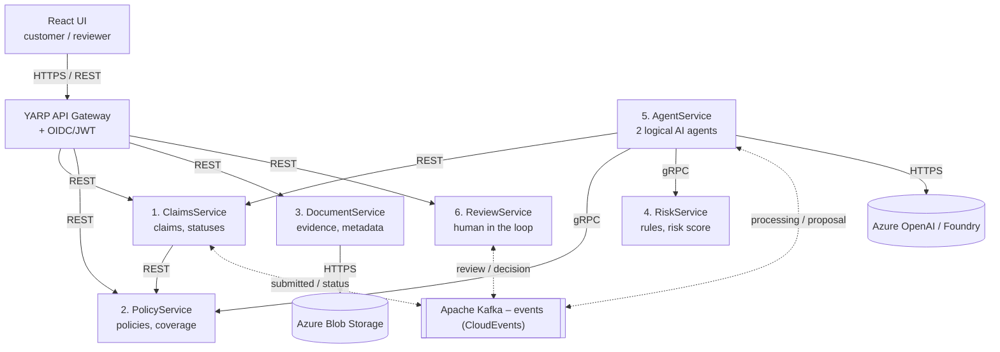

# Zavarovalnica Horica

An insurance company where AI agents help process damage claims, while employees
confirm the risky decisions. Project for RSO 2026/27, group 3.

> ⚠️ Prototype with fictional data only. It is not intended for real claims.

This repository holds the project documentation. The full project application is in
[`prijava_teme.PDF`](prijava_teme.PDF) (in Slovenian).

## About the project

Handling a damage claim means checking that the policy is valid, collecting evidence and
judging whether the claim is justified. Much of this is repetitive, so we automate part of it
and keep human oversight for the harder decisions.

Customers use a web app to report damage, attach documents (photos, receipts, invoices …)
and follow the state of their claim. The system is built from **six microservices**. Two
logical agents inside one of them collect data through the existing APIs, check the
conditions and prepare a proposal. Simple claims can be closed automatically by fixed rules;
claims with higher risk are reviewed by an employee. The application is built on **.NET** and
deployed to **Microsoft Azure**.

## Architecture

Each of the six services has its own logical **PostgreSQL** database. The web UI, API Gateway,
Kafka, the databases and the other services are supporting components.

- **Synchronous calls (REST, gRPC)** are used to fetch data.
- **Asynchronous events (Kafka)** carry state changes, because handling a claim can take hours or days.
- **Every decision is recorded**, so we can check how a claim reached its final state.
- Kafka on AKS will be installed with **Strimzi**.

### Events

| Event | Published by | When |
|---|---|---|
| `claim.submitted.v1` | ClaimsService | A customer submits a claim |
| `document.added.v1` | DocumentService | A document is added to a claim |
| `claim.recommendation.created.v1` | AgentService | The agents finish their analysis |
| `review.requested.v1` | ClaimsService | The claim needs an employee |
| `review.completed.v1` | ReviewService | The employee has decided |

## Microservices

| # | Service | Responsibility | Interfaces |
|---|---|---|---|
| 1 | **ClaimsService** | Submitting claims, their status and handling history. Owns the final state of a claim. Publishes events on every change. | REST, e.g. `POST /claims`, `GET /claims/{id}` |
| 2 | **PolicyService** | Policies, validity and types of coverage. Lets other services check whether a policy covers the reported damage. | REST, gRPC |
| 3 | **DocumentService** | Uploading photos, invoices and other attachments, checking them and storing them in Azure Blob Storage. Other services read document data through its API. Publishes `document.added.v1`. | REST |
| 4 | **RiskService** | Business rules and risk: coverage conditions, claim amount, completeness of documents and other factors. Returns a risk score and the reasons for a manual review. The rules are kept separate from the language model, so results can be checked. | gRPC |
| 5 | **AgentService** | Two logical agents. The first collects data about the claim, policy and documents through the APIs. The second uses the checked data and the RiskService result to write a summary and a proposal, sent as `claim.recommendation.created.v1`. It never confirms a risky claim on its own. | REST, gRPC, Kafka |
| 6 | **ReviewService** | Creates tasks for claims that need a human review. The employee approves, rejects or asks for more documents. Stores the reason and time of the decision and publishes `review.completed.v1`. | REST, Kafka |

### Automatic approval

In the first version a claim is approved automatically only with **a valid policy, complete
documents, an amount up to 300 € and a risk score of at most 0.20**. Higher amounts, unclear
cases and proposed rejections always go to an employee. These limits are a starting point
and may change during development.

## Use cases

| ID | Use case | Description |
|---|---|---|
| UC-1 | Check a policy | The customer checks that their insurance is valid and what it covers. |
| UC-2 | Submit a claim | The customer reports a damage event and enters the amount claimed. |
| UC-3 | Add documents | The customer attaches photos, receipts or other evidence. |
| UC-4 | Track status | The customer follows the handling of the claim and any requests for more documents. |
| UC-5 | Automatic handling | The system checks a simple claim and can approve it by the rules. |
| UC-6 | Manual review | An employee reviews a higher-risk claim and makes the decision. |
| UC-7 | Re-analysis | After new documents arrive, the system checks the claim again. |
| UC-8 | History | An authorised employee looks through the decisions and changes on a claim. |

### Main scenario: UC-6, a claim confirmed by a person

A claim for **1.200 €** is above the auto-approval limit, so an employee has to decide.

1. The customer submits the claim with a photo and an invoice. ClaimsService stores the claim, DocumentService the documents.
2. ClaimsService publishes `claim.submitted.v1` to Kafka.
3. AgentService picks up the event. The first agent gets data from ClaimsService, PolicyService and DocumentService.
4. RiskService checks the business rules and calculates the risk score. The second agent writes a summary and a proposal.
5. The agent publishes the proposal to Kafka. Because of the higher amount, ClaimsService sends the claim to manual review with `review.requested.v1`.
6. ReviewService creates a task. The employee checks the documents and the proposal and approves, rejects or asks for more documents.
7. ReviewService publishes `review.completed.v1`; ClaimsService updates the state and stores the reason for the decision.
8. The customer sees the new state in the web app.

## Technologies

| Area | Tools |
|---|---|
| Backend | C#, .NET |
| Frontend | React, TypeScript (separate views for customers and employees) |
| API Gateway | YARP |
| Communication | REST, gRPC, Apache Kafka (CloudEvents, Strimzi on AKS) |
| Data | PostgreSQL on Azure (one logical database per service), Azure Blob Storage for files |
| AI | LLMs such as Google Gemini or Grok; Azure Vision and Foundry tools for images |
| Authentication | OAuth 2.0 / OpenID Connect with Keycloak |
| Development | Visual Studio, Visual Studio Code, Docker Compose for the local environment |
| Deployment | Docker Hub for images, Azure Kubernetes Service (AKS) |
| CI/CD | GitHub Actions |
| Monitoring | OpenTelemetry, Prometheus, Grafana (as needed) |
| Testing | xUnit, Testcontainers |

Tools and approaches may change during development (for example the authentication setup).

## Repositories

All code is in the [ZavarovalnicaHorica](https://github.com/ZavarovalnicaHorica) GitHub organisation.

| Repository | Contents |
|---|---|
| [insureflow-docs](https://github.com/ZavarovalnicaHorica/insureflow-docs) | This repository: documentation and the project application |
| [web-ui](https://github.com/ZavarovalnicaHorica/web-ui) | React + TypeScript web app (customer and employee views) |

The repositories for the services and the deployment configuration will be added here as they are created.

## Team

**Zavarovalnica Horica**, project group 3

- Sandi Cejan
- Miha Maksimiljan Bertoncelj
- Kristjan Brataševec
